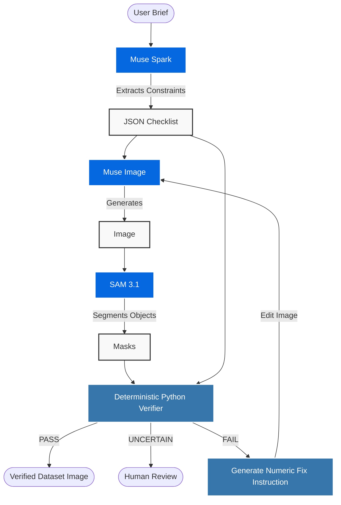

# Image Unit Tests


**A self-verifying image-generation agent that uses explicit constraints and human review to assess whether synthetic images are ready for computer-vision datasets.**

## The Problem

Image generators can miss exact requirements: the number of objects, their
position, or whether something is absent. Synthetic images can therefore look
plausible while carrying incorrect labels—making them risky inputs for
computer-vision training.

An image model's own judgment is not enough. This project tests a segmentation
verifier and a feedback loop against explicit constraints, then compares the
verifier's decisions with blinded human counts.

## Architecture



The pipeline has four main steps:

- **Spark** converts the user's brief into a structured JSON checklist.
- **Image** generates an image and applies numeric correction instructions
  when the verifier finds a mismatch.
- **SAM 3.1** segments requested objects to produce masks for evaluation.
- **Python** deterministically checks the masks against the constraints and
  returns **PASS**, **FAIL**, or **UNCERTAIN** for human review.

## The Honest Finding (The Results)

**We tested whether a segmentation-based verifier can close the loop on image generation. Numeric feedback steered the editor, but SAM couldn't certify the result.**

### Human-verified single-step results

On the **N=19 hard-overcount pilot**, mean absolute error reduction was:

| Condition | Mean Error Reduction (Human-Verified) |
| :--- | ---: |
| Numeric Feedback | +3.79 |
| Generic Feedback | +0.74 |
| Marked Image | +0.11 |
| Control | -0.37 |

Error reduction is starting human-counted absolute error minus edited
human-counted absolute error; positive values mean lower error. Numeric
feedback's mean reduction was about **5.1x** Generic feedback's.

### Yield and verifier reliability

**The Yield Funnel:** 105 generated → 84 edited → 11 SAM-passed → 3
human-correct → 1 artifact-free.

Among **11 images SAM passed**, blinded human counts disagreed on **8**:
**72.7%** (95% Wilson CI: 43%–90%). Human review found artifacts in 7/21
starting images (33.3%) and 25/84 edited images (29.8%); this is a descriptive
comparison, not a significance test.

Only 1/21 Numeric outcomes (4.8%) had both the expected human count and no
reported artifact. The one surviving image is exported in COCO-shaped form as
a **format demonstration**, with a placeholder full-frame box rather than an
instance-level mask or label.

## How to Run

### Prerequisites

Install dependencies:

```bash
pip install -r requirements.txt
```

For live API access, copy the example environment file and configure the
required credentials:

```bash
cp .env.example .env
```

Set `META_API_KEY`, `BASETEN_API_KEY`, and any Baseten configuration values
required by `config.yaml`. Keep `.env` private; it is git-ignored.

### Quick start: UI

```bash
python -m src.ui.app
```

Select **Demo replay** and choose **Apples** to view the saved scenario. The
`runs/demos/` folder contains offline replays that do not require API keys.

## Project Structure & Limitations

- `src/` — agent, clients, deterministic verifier, and UI.
- `scripts/` — evaluation, blinded audit, analysis, and export utilities.
- `runs/demos/` — saved UI replay scenarios.
- `runs/export/` — the single human-verified, artifact-free COCO-format
  demonstration image and annotation.

This was a **small hard-count pilot**: n=19 hard overcounts; undercounts
(n=2) were excluded. Human labels came from one primary counter plus one
recounter. Multi-round evaluation crashed and did not complete, so no
comparative multi-round success claim is made. The edited-image CSV does not
preserve per-image `UNCERTAIN` statuses, so the flag's catch rate for SAM's
false passes cannot be calculated from this audit.
